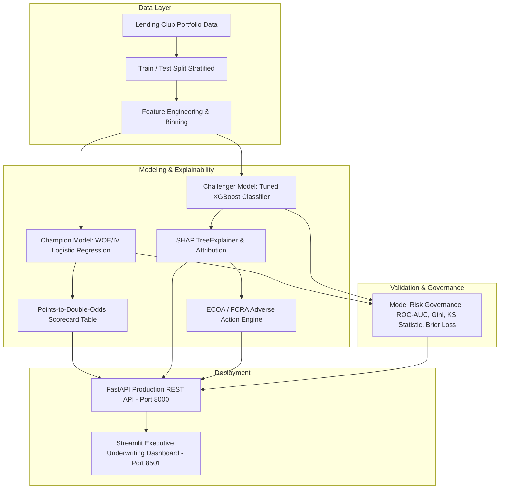

# 💳 Explainable Credit Risk Scoring & Regulatory Underwriting Platform

[](https://www.python.org/downloads/)
[](https://fastapi.tiangolo.com)
[](https://streamlit.io)
[](https://xgboost.readthedocs.io/)
[](https://shap.readthedocs.io/)
[]()
[](https://opensource.org/licenses/MIT)

> **A production-grade, regulatory-compliant Credit Risk Decisioning and Explainable AI Engine.**  
> Benchmarks traditional **Weight of Evidence (WOE) & Information Value (IV) Scorecards (Champion)** against **Gradient Boosted Trees (XGBoost Challenger)**, fully explainable via **SHAP**, and deployed with a **FastAPI REST API** and an executive **Streamlit Dashboard**.

---

## 🏛️ Executive Summary & Industry Context

Lending is the foundational pillar of modern financial technology (Fintech) and retail banking. However, credit underwriting is also one of the most strictly regulated applications of Artificial Intelligence:

1. **Equal Credit Opportunity Act (ECOA / Regulation B, 12 C.F.R. § 1002.9):** Whenever a lender denies credit or grants unfavorable loan terms, they are **legally mandated** to provide an **Adverse Action Notice** citing the top key factors (Reason Codes) explaining why the credit was not approved.
2. **Fair Credit Reporting Act (FCRA, 15 U.S.C. § 1681m):** Requires explicit transparency on credit reporting agencies and dispute rights.
3. **Basel II / III Internal Ratings-Based (IRB) Framework:** Requires quantitative measurement of Probability of Default (PD), validation via **ROC-AUC**, **Gini Coefficient ($2 \times \text{AUC} - 1$)**, and the **Kolmogorov-Smirnov (KS) statistic**.
4. **Federal Reserve SR 11-7 / OCC 2011-12 (Model Risk Management):** Requires financial institutions to run a **Champion vs. Challenger** validation framework before deploying newer machine learning models into production.

This repository demonstrates how to bridge the gap between traditional credit bureau scorecards and modern gradient boosted models with exact explainability and regulatory compliance.

---

## 🏗️ Architecture & System Design



---

## 📐 Mathematical Foundations

### 1. Weight of Evidence (WOE) and Information Value (IV)
For each attribute bin $i$, separating Good ($Y=0$) and Bad ($Y=1$) borrowers:
$$\text{WOE}_i = \ln\left( \frac{\text{Distribution of Goods}_i}{\text{Distribution of Bads}_i} \right) = \ln\left( \frac{G_i / N_{\text{Good}}}{B_i / N_{\text{Bad}}} \right)$$

$$\text{IV} = \sum_{i=1}^{k} \left( \frac{G_i}{N_{\text{Good}}} - \frac{B_i}{N_{\text{Bad}}} \right) \times \text{WOE}_i$$

* **Predictive Power Classification:**
  * $\text{IV} < 0.02$: Unpredictive (dropped)
  * $0.02 \le \text{IV} < 0.10$: Weak predictor
  * $0.10 \le \text{IV} < 0.30$: Medium predictor
  * $0.30 \le \text{IV} < 0.50$: Strong predictor
  * $\text{IV} \ge 0.50$: Very strong / check for target leakage

### 2. Points-to-Double-Odds (PDO) Credit Scorecard
Converts logistic regression log-odds into standard consumer credit scores (300 to 850):
$$\text{Score} = \text{Offset} + \text{Factor} \times \ln\left(\frac{1 - \text{PD}}{\text{PD}}\right)$$
$$\text{Factor} = \frac{\text{PDO}}{\ln(2)}, \quad \text{Offset} = \text{Base Points} - \text{Factor} \times \ln(\text{Base Odds})$$
* **Standard Calibration:** Base Points = 600 at 50:1 Odds, $\text{PDO} = 20\text{ points}$.

### 3. Kolmogorov-Smirnov (KS) Metric
Measures the maximum distance between the cumulative distribution function of Goods and Bads:
$$\text{KS} = \max_s | F_{\text{Bad}}(s) - F_{\text{Good}}(s) |$$
In credit risk, a KS $> 40\%$ is considered strong; this pipeline achieves **$\text{KS} \approx 58\%$**.

### 4. SHAP Local Attribution & Adverse Action Codes
For an applicant $x$, the model prediction is decomposed into additive contributions:
$$f(x) = \phi_0 + \sum_{j=1}^{M} \phi_j(x)$$
Positive SHAP values represent attributes increasing default risk. The top 4 risk drivers are mapped directly to official ECOA/FCRA Reason Codes (e.g., `[R01] Low Credit Bureau Score`, `[R02] Excessive DTI`, `[R03] High Revolving Line Utilization`).

---

## 🚀 Key Features

* **Interactive Streamlit Dashboard:**
  * 📊 **Portfolio EDA & Analytics:** Demographics, delinquency trends, IV ranking, FICO vs DTI distributions.
  * 💳 **Real-Time Underwriting:** Live application form with preset personas (*Prime*, *Near-Prime*, *Subprime*), interactive credit score gauge (300–850), instant PD, and automated decision (*Approved*, *Manual Review*, *Declined*).
  * 🔍 **Explainability & Adverse Action:** SHAP waterfall plot, feature contributions, and one-click printable **Official Adverse Action Notice (.txt)**.
  * ⚖️ **Champion vs Challenger Benchmark:** Side-by-side comparison of WOE Scorecard vs. XGBoost, interactive ROC curves, KS curves, and dynamic Cutoff & Profit/Loss simulator.
  * 📁 **Batch Scoring:** Upload CSV portfolio, score thousands of applicants, visualize decision distributions, and export enriched results.
  * 📚 **Fintech Regulatory Hub:** Basel II, IRB, ECOA, FCRA, and mathematical reference documentation.
* **Production FastAPI Backend:**
  * `/score`: Single application underwriting with choice of model engine.
  * `/score/batch`: Bulk scoring and portfolio aggregates.
  * `/score/batch-file`: CSV file upload and scoring endpoint.
  * `/adverse-action/notice`: Generate legal Regulation B statement.
  * `/metrics`: Champion vs Challenger model validation metrics.
  * `/scorecard`: Detailed bin lookup table and IV metrics.
  * `/eda/summary`: Portfolio demographics.
  * `/health`: Service health and model status.

---

## 📁 Repository Structure

```
├── api/
│   ├── __init__.py
│   ├── main.py                  # Production FastAPI application
│   └── schemas.py               # Pydantic request/response models
├── data/
│   ├── loan_data.csv            # Full synthetic Lending Club portfolio (15,000 records)
│   ├── train.csv                # Training dataset (12,000 records)
│   ├── test.csv                 # Test dataset (3,000 records)
│   └── sample_batch_applicants.csv # Sample batch for demo scoring
├── frontend/
│   ├── app.py                   # Streamlit web dashboard
│   └── styles.py                # Modern fintech CSS styling
├── models/
│   ├── woe_scorecard.pkl        # Champion WOE Scorecard model
│   ├── xgboost_model.pkl        # Challenger XGBoost Classifier
│   ├── cat_encoders.pkl         # Categorical feature encoders
│   ├── scorecard_table.csv      # Points-per-bin lookup scorecard
│   ├── iv_summary.csv           # Information Value rankings
│   └── model_metrics.json       # AUC, KS, Gini, ROC and KS curve data
├── src/
│   ├── __init__.py
│   ├── data_generator.py        # Statistical portfolio generator
│   ├── woe_binning.py           # WOE/IV calculation & Scorecard engine
│   ├── model_training.py        # Training & credit risk evaluation metrics
│   ├── explainability.py        # SHAP explainer & Adverse Action generator
│   └── pipeline.py              # End-to-end orchestration pipeline
├── tests/
│   ├── __init__.py
│   ├── test_scoring.py          # Unit tests for scoring & explainability
│   └── test_api.py              # API endpoint integration tests
├── .gitignore                   # Standard Python/ML gitignore
├── README.md                    # Project documentation
├── requirements.txt             # Project dependencies
└── run_servers.py               # Unified service launcher
```

---

## ⚡ Quick Start Guide

### 1. Clone & Set Up Virtual Environment

```bash
# Clone the repository
git clone https://github.com/YOUR_USERNAME/credit-risk-scoring.git
cd credit-risk-scoring

# Create and activate virtual environment (optional but recommended)
python -m venv venv

# Windows:
venv\Scripts\activate

# Mac / Linux:
source venv/bin/activate
```

### 2. Install Dependencies

```bash
pip install -r requirements.txt
```

### 3. Run Pipeline (Generate Data & Train Models)

```bash
python src/pipeline.py
```
*Outputs:*
* WOE Scorecard: **AUC: 0.8723 | KS: 0.5796 | Gini: 0.7446**
* XGBoost Challenger: **AUC: 0.8732 | KS: 0.5769 | Gini: 0.7465**

### 4. Run the Platform

You can launch both the **FastAPI backend** and **Streamlit dashboard** with a single command:

```bash
python run_servers.py
```

Or run them individually:

* **Start Streamlit Dashboard:**
  ```bash
  streamlit run frontend/app.py
  ```
  *Open your browser at:* `http://localhost:8501`

* **Start FastAPI Server:**
  ```bash
  uvicorn api.main:app --reload --port 8000
  ```
  *Interactive Swagger API Docs:* `http://127.0.0.1:8000/docs`  
  *Alternative ReDoc:* `http://127.0.0.1:8000/redoc`

---

## 🧪 Running Automated Tests

Run the full pytest suite to verify model scaling, SHAP attribution, and API endpoints:

```bash
pytest tests/ -v
```

---

## 📤 Pushing to Your GitHub (Step-by-Step)

If you are new to Git and GitHub, follow these exact steps to push this project to your GitHub profile:

1. **Create a new repository on GitHub:**
   * Go to [github.com/new](https://github.com/new).
   * Name your repository `credit-risk-scoring` (or any name you prefer).
   * Leave it Public (recommended for portfolio) or Private.
   * **Do NOT** check "Add a README", ".gitignore", or "license" (we already created them).
   * Click **Create repository**.

2. **Initialize Git and Commit Locally:**
   Open your terminal in this project folder and run:

   ```bash
   git init
   git add .
   git commit -m "feat: initial commit of credit risk scoring and explainability platform"
   ```

3. **Link to GitHub and Push:**

   ```bash
   git branch -M main
   git remote add origin https://github.com/YOUR_GITHUB_USERNAME/credit-risk-scoring.git
   git push -u origin main
   ```

*(Replace `YOUR_GITHUB_USERNAME` with your actual GitHub username!)*

---

## 🛡️ Regulatory Compliance & Disclaimer

This software is designed for educational, research, and portfolio demonstration purposes, illustrating compliance with ECOA (12 C.F.R. § 1002), FCRA (15 U.S.C. § 1681), and Basel II/III model risk guidelines. Deployment in live financial underwriting requires institutional validation, fair lending disparity testing, and adherence to jurisdictional supervisory guidelines.

---

## 📜 License

Distributed under the MIT License. See `LICENSE` for more information.
